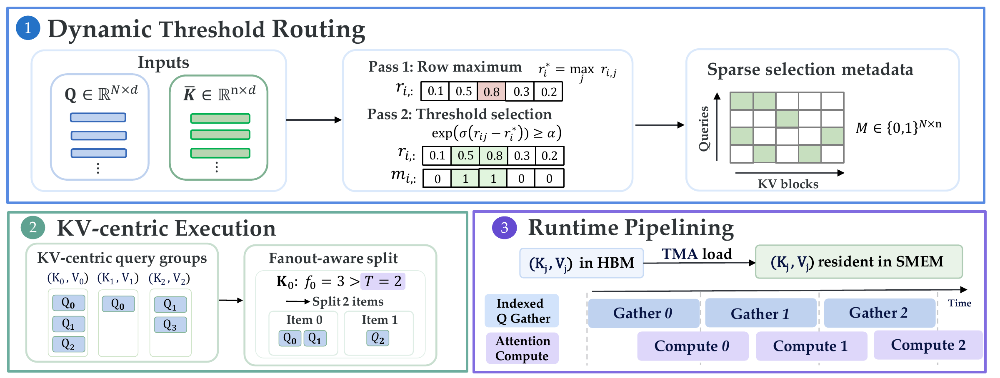

# LightningMoBA

LightningMoBA co-designs dynamic routing, KV-centric execution, and runtime pipelining for long-context sparse attention. It replaces fixed per-query Top-K retention with threshold-based selection, groups selected queries by KV block with fanout-aware work partitioning, and overlaps data movement with Tensor Core computation on Hopper GPUs.



*Figure 1 from the paper. Dynamic routing produces variable-cardinality sparse metadata; KV-centric execution splits high-fanout columns into bounded work items; runtime pipelining reuses resident KV tiles while overlapping query gathers and attention computation.*

## Main Results

LightningMoBA is evaluated against FlashMoBA at matched average retention budgets. The main evaluation uses the full 6,500-example RULER suite, across six context lengths (4K–128K), with TP=8 and batch size 1.

### End-to-end inference

At the Top-16 reference budget, LightningMoBA achieves 1.20–1.60× end-to-end speedup across five checkpoints, while the overall mean RULER score increases from 74.42 to 75.28.

| Model | RULER score (FlashMoBA → Ours) | End-to-end speedup |
|---|---:|---:|
| Qwen3-4B | 72.43 → 75.53 | 1.53× |
| GQA-30B-A3B | 71.87 → 71.01 | 1.58× |
| Qwen3-235B-A22B | 82.18 → 83.08 | 1.60× |
| Llama-3.1-8B | 73.99 → 75.47 | 1.42× |
| Qwen3-32B-YaRN4 | 71.65 → 71.29 | 1.20× |

Scores and end-to-end speedups are computed from the six-length averages for each model. End-to-end timing measures the complete RULER generation loop, not single-request latency; both methods use CUDA Graph dense decoding. GQA-30B-A3B is an internal checkpoint.

### Kernel and routing efficiency

- 2.16–2.56× faster complete attention device path at Top-32, including routing, sparse-index/worklist construction, attention, and output merging.
- 6.99–11.25× faster routing + CSC construction at Top-64, measured separately from attention.

These are controlled GPU measurements on captured Qwen3-4B and GQA-30B-A3B tensors, not end-to-end model speedups. Full per-length results, ablations, and additional comparisons are reported in the paper.

The package also provides standard Top-K sparse attention and a fine-grained Block-8 interface; see [Usage](#usage) for supported execution paths and constraints.

## Setup

### 1. Environment

Build from source in a Linux environment with:

- An NVIDIA GPU and a CUDA-enabled PyTorch installation.
- A CUDA Toolkit compatible with the installed PyTorch build, including `nvcc`, and a C++17 compiler.
- Python 3.9 or newer, using a Python version supported by your PyTorch and Triton releases.

For the block8 CUDA backend, use an SM90 GPU and a compatible CUDA 12.x toolkit. This backend requires BF16 inputs with head dimension 128. Other entry points have different constraints; see [Usage](#usage).

Check the active environment before building:

```bash
python -c "import torch; print('PyTorch:', torch.__version__); print('CUDA:', torch.version.cuda); print('GPU available:', torch.cuda.is_available())"
nvcc --version
```

### 2. Installation

After installing CUDA-enabled PyTorch, run the following from the repository root:

```bash
python -m pip install setuptools wheel ninja packaging psutil
MAX_JOBS=2 python -m pip install --no-build-isolation -e '.[test]'
```

The package is imported as `lightning_moba`; its compiled extension is `lightning_moba_cuda`. The shared extension includes block8 CUDA attention, so there is no separate block8 library to compile at runtime.

`MAX_JOBS` limits build parallelism. The default CUDA targets are `80;90a`; `LIGHTNING_MOBA_CUDA_ARCHS` overrides this list and `NVCC_THREADS` controls compiler threads. For a Hopper-only build, set `LIGHTNING_MOBA_CUDA_ARCHS='90a'` before installation. Rebuild the extension when changing PyTorch, CUDA, or the C++ ABI.

Check the installed modules:

```bash
python -c "import lightning_moba, lightning_moba_cuda; print(lightning_moba.__version__); print(lightning_moba.__file__); print(lightning_moba_cuda.__file__)"
```

## Usage

Inputs use token-major layout: Q has shape `[total_q, query_heads, head_dim]`, and K/V have shape `[total_k, kv_heads, head_dim]`. Q/K/V must use compatible floating-point dtypes on the same CUDA device, and `query_heads` must be divisible by `kv_heads`. Packed variable-length inputs use contiguous CUDA `int32` cumulative-length tensors.

### 1. Top-K block-sparse attention

`lightning_moba_varlen_func` combines mean pooling, Top-K routing, CSC index construction, and sparse attention. The standard attention path provides forward and backward implementations.

```python
import torch
from lightning_moba import lightning_moba_varlen_func

seq_len = 2048
q = torch.randn(seq_len, 4, 128, device="cuda", dtype=torch.bfloat16)
k = torch.randn(seq_len, 1, 128, device="cuda", dtype=q.dtype)
v = torch.randn_like(k)
cu_seqlens = torch.tensor([0, seq_len], device="cuda", dtype=torch.int32)

out = lightning_moba_varlen_func(
    q, k, v,
    cu_seqlens, cu_seqlens,
    max_seqlen_q=seq_len,
    max_seqlen_k=seq_len,
    moba_chunk_size=128,
    moba_topk=4,
    causal=True,
)
print(out.shape)
```

`moba_chunk_size` is the number of tokens per routing block, while `moba_topk` is the block-selection budget. For packed batches, concatenate the sequences and provide their cumulative lengths and maximum individual lengths. To train through this path, use Q/K/V tensors connected to an autograd graph; the discrete routing decision itself is not a differentiable Top-K operation.

### 2. Dynamic-threshold block8 attention

`lightning_moba_block8_func` selects 8-token key blocks using a scalar relative threshold, then computes causal attention over the selected tokens. It is an inference-only interface and requires Q/K/V with `requires_grad=False`.

The following example uses the SM90 CUDA backend:

```python
import torch
from lightning_moba import lightning_moba_block8_func

seq_len = 512
q = torch.randn(seq_len, 4, 128, device="cuda", dtype=torch.bfloat16)
k = torch.randn(seq_len, 1, 128, device="cuda", dtype=q.dtype)
v = torch.randn_like(k)

out, counts = lightning_moba_block8_func(
    q, k, v,
    alpha=0.9,
    backend="cuda",
    tail_backend="sdpa",
    return_counts=True,
)
print(out.shape)
print("Mean visible tokens:", counts.float().mean().item())
```

The selection and execution rules are:

- `alpha` is one finite scalar in `(0, 1]`, shared across heads within a call. Non-anchor blocks are selected by comparing their pooled scores against the eligible row maximum plus `log(alpha)`. Larger values make selection more restrictive; `alpha=1` is not dense attention, and `alpha=0` is invalid.
- `sink` and `window` count logical **8-token blocks**, not execution tiles. Defaults are `sink=1` and `window=2`, retaining the first block and the current/preceding blocks, subject to the final causal mask.
- There is no fixed token budget or per-row cap. Retained tokens vary with the input. `counts` reports visible token counts with shape `[query_tokens, query_heads]`, including dense-tail tokens.
- Q positions are interpreted as a suffix of the K sequence. Queries beyond the 256-token-aligned K prefix use dense causal suffix attention over the full K/V sequence. Inputs shorter than 256 tokens use this dense path throughout.
- `backend="cuda"` requires SM90, BF16, and head dimension 128. `backend="triton"` accepts FP16/BF16 and head dimensions 32, 64, 128, or 256, with the default sink/window settings.
- `tail_backend="sdpa"` uses PyTorch SDPA and does not require vLLM. The default `"auto"` can use vLLM's FA3 implementation on SM90 when available; `"flash"` explicitly requires that optional backend.

For packed inputs, use `lightning_moba_block8_varlen_func`. It dispatches sequences independently and synchronizes cumulative-length metadata to the CPU; it is not a fused multi-sequence kernel or a CUDA-graph-safe interface.

See the [block8 example](examples/block8_attention.py) and [block8 interface](lightning_moba/block8/interface.py) for more details.

### 3. Separate routing and KV-centric inference

Advanced callers can construct a sparse pattern separately and choose the attention implementation:

| Entry point | Purpose |
|---|---|
| `flash_topk_varlen_func` | Build a Top-K CSC pattern; returns column offsets, column counts, and row indices by default. |
| `lightning_moba_attn_varlen_func` | Run standard sparse attention over a supplied CSC pattern, with autograd support. |
| `lightning_moba_cuda_kv_centric_func` | Run KV-centric inference over a supplied CSC pattern. |
| `lightning_moba_streaming_kv_centric_func` | Explicit streaming prefill with bounded partial-output storage; returns output and head-major LSE. |

When routing and attention are called separately, keep their block sizes consistent: `lg_block_n` in standard attention must match the routing `moba_chunk_size`. Note that the routing function takes `moba_topk` before `moba_chunk_size`, unlike the combined interface.

The KV-centric interfaces are for inference, not replacements for the standard backward path. Eligible prefill calls use streaming by default. `LIGHTNING_MOBA_STREAM_CHUNK_EDGES` controls partial-output capacity and defaults to `2000000`; setting it to `0` disables automatic streaming. The explicit streaming interface requires a positive capacity and is eager-only. CSC and query-index metadata still scale with the total number of selected associations.

See the [standard interfaces](lightning_moba/lightning_moba_interface.py), [KV-centric implementation](lightning_moba/triton_kv_centric.py), and [streaming implementation](lightning_moba/streaming_kv_centric.py) for signatures and input constraints.

## Tests and Benchmarks

Install the test extra as shown above. On an SM90 GPU, run the public-interface and block8 regression suite with:

```bash
make test PYTHON=python
```

This target runs the public-interface non-CUDA tests, the CUDA tests in the public-interface and block8 test files, and the TopK selector correctness tests. It is not the entire test suite. `make test-cpu PYTHON=python` runs only the non-CUDA public-interface tests, but still requires an importable package and compiled extension; it is not a CPU-only installation mode.

Additional GPU suites cover standard attention forward/backward and streaming KV-centric inference:

```bash
python -m pytest -q tests/test_moba_attn.py
python -m pytest -q tests/test_streaming_kvcentric.py
```

Hardware-specific cases and optional integrations have their own prerequisites. The optional external backend checks are not part of a standalone package installation.

Performance scripts are provided in [benchmarks](benchmarks):

- [End-to-end Top-K attention](benchmarks/bench_lightning_moba.py), including routing.
- [Attention-only timing](benchmarks/bench_lightning_moba_attn.py), with routing outside the timed region.
- [Memory measurements](benchmarks/bench_lightning_moba_memory.py).
- Component benchmarks for [Top-K](benchmarks/bench_flash_topk.py), [mean pooling](benchmarks/bench_triton_mean_pool.py), and [sorting](benchmarks/bench_varlen_sort.py).

Benchmarks may require additional packages, including FlashAttention, NumPy, and pandas. Inspect each script's dependencies and workload sizes before running it. End-to-end and attention-only timings measure different work; compare results using the same inputs, selection settings, and hardware.

## Acknowledgements

LightningMoBA builds on FlashMoBA and [FlashAttention](https://github.com/Dao-AILab/flash-attention), and uses [CUTLASS](https://github.com/NVIDIA/cutlass), [PyTorch](https://github.com/pytorch/pytorch), and [Triton](https://github.com/triton-lang/triton). We thank their authors and maintainers. Upstream copyright notices and third-party licenses are retained in the source tree.

## License

Copyright (C) 2026 Tencent. LightningMoBA is licensed under the BSD-3-Clause [LICENSE](LICENSE).
